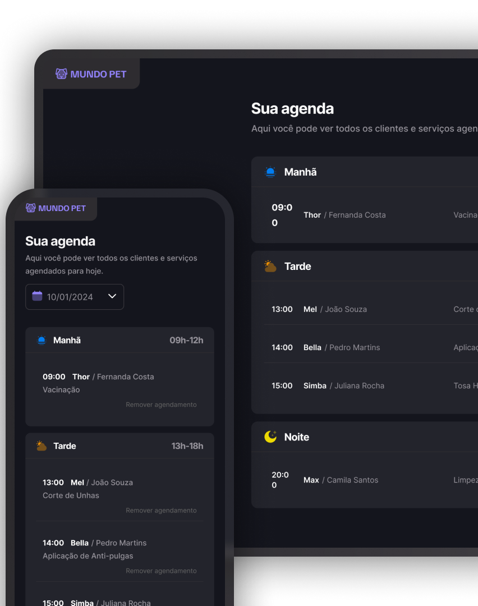

<h1 align="center">🐾 Mundo Pet</h1>

<p align="center">
  Uma aplicação web responsiva para gerenciamento de agendamentos de um pet shop, desenvolvida com HTML, CSS, JavaScript e Webpack.
</p>

<p align="center">
  <a href="#-tecnologias">Tecnologias</a>
  &nbsp;&nbsp;&nbsp;|&nbsp;&nbsp;&nbsp;
  <a href="#-projeto">Projeto</a>
  &nbsp;&nbsp;&nbsp;|&nbsp;&nbsp;&nbsp;
  <a href="#-funcionalidades">Funcionalidades</a>
  &nbsp;&nbsp;&nbsp;|&nbsp;&nbsp;&nbsp;
  <a href="#-como-executar">Como executar</a>
  &nbsp;&nbsp;&nbsp;|&nbsp;&nbsp;&nbsp;
  <a href="#-aprendizados">Aprendizados</a>
</p>

<br>

<p align="center">
  
</p>


## 🚀 Tecnologias

Esse projeto foi desenvolvido utilizando:

- HTML
- CSS
- JavaScript
- Webpack
- Git e GitHub

## 💻 Projeto

O **Mundo Pet** é uma aplicação web de agendamento de serviços para pet shops, desenvolvida como prática durante a Formação Full Stack da Rocketseat.

O projeto permite cadastrar atendimentos, consultar a agenda por data, visualizar os agendamentos organizados por período e remover registros. O formulário valida as informações inseridas, impede horários duplicados e bloqueia novos agendamentos em datas ou horários que já passaram.

A interface é responsiva e utiliza seletores nativos de data e horário para facilitar o preenchimento.

**Observação:** nesta versão, os agendamentos são armazenados em um array JavaScript. Eles não são persistidos e são perdidos ao atualizar a página.

## ✨ Funcionalidades

- Cadastro do nome do tutor, nome do pet, telefone e descrição do serviço
- Seleção da data e do horário do atendimento
- Abertura dos seletores de data e horário pelos ícones da interface
- Validação de campos obrigatórios e do número de telefone
- Bloqueio de agendamentos em datas passadas
- Bloqueio de horários que já passaram no dia atual
- Bloqueio de agendamentos duplicados na mesma data e horário
- Listagem dos agendamentos por período:
  - Manhã
  - Tarde
  - Noite
- Filtragem dos atendimentos pela data selecionada
- Ordenação dos agendamentos por horário
- Atualização automática da data exibida após o cadastro
- Confirmação do agendamento com data e horário
- Remoção de agendamentos
- Abertura e fechamento do modal de cadastro
- Layout responsivo

## ⚙️ Como executar

É necessário ter **Node.js** e **npm** instalados.

Clone o projeto:

```bash
git clone URL_DO_REPOSITORIO
```

Entre na pasta do projeto:

```bash
cd NOME_DA_PASTA
```

Instale as dependências:

```bash
npm install
```

Inicie a aplicação em ambiente de desenvolvimento:

```bash
npm run dev
```

Com a configuração atual do Webpack Dev Server, a aplicação pode ser acessada em:

```text
http://localhost:3000
```

Para gerar os arquivos de produção:

```bash
npm run build
```

## 🧠 Aprendizados

Durante o desenvolvimento desse projeto, pude praticar e aprofundar conhecimentos em:

- Manipulação do DOM
- Eventos no JavaScript e `addEventListener`
- Funções, callbacks e arrow functions
- Arrays, objetos e métodos como `filter`, `sort`, `some`, `push` e `splice`
- Validação de formulários com `FormData`
- Manipulação e comparação de datas e horários
- Criação dinâmica de elementos HTML
- Uso de `event.target` e propagação de eventos
- Uso de `showPicker()` em campos de data e horário
- Modularização do código com ES Modules
- Organização e execução de projetos com npm e Webpack
- Testes manuais, identificação e correção de erros
- Responsividade e versionamento com Git e GitHub

## 📂 Estrutura do projeto

```text
mundo-pet/
├── src/
│   ├── assets/
│   ├── modules/
│   │   ├── form.js
│   │   ├── modal.js
│   │   └── schedules.js
│   ├── styles/
│   └── main.js
│
├── index.html
├── webpack.config.js
├── package.json
└── package-lock.json
```

---

<p align="center">
  Desenvolvido por <strong>Victor Koithi</strong> 👨‍💻
</p>

<p align="center">
  <a href="https://github.com/vkoithi">GitHub</a>
  &nbsp;&nbsp;•&nbsp;&nbsp;
  <a href="https://www.linkedin.com/in/vkoithi">LinkedIn</a>
</p>
